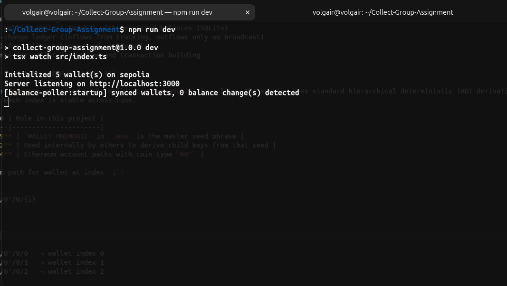
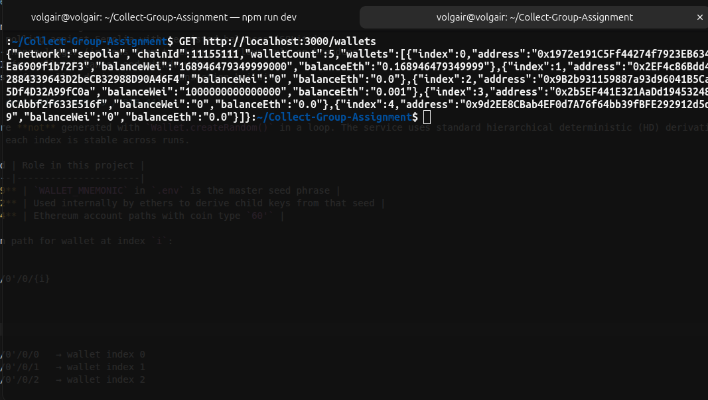
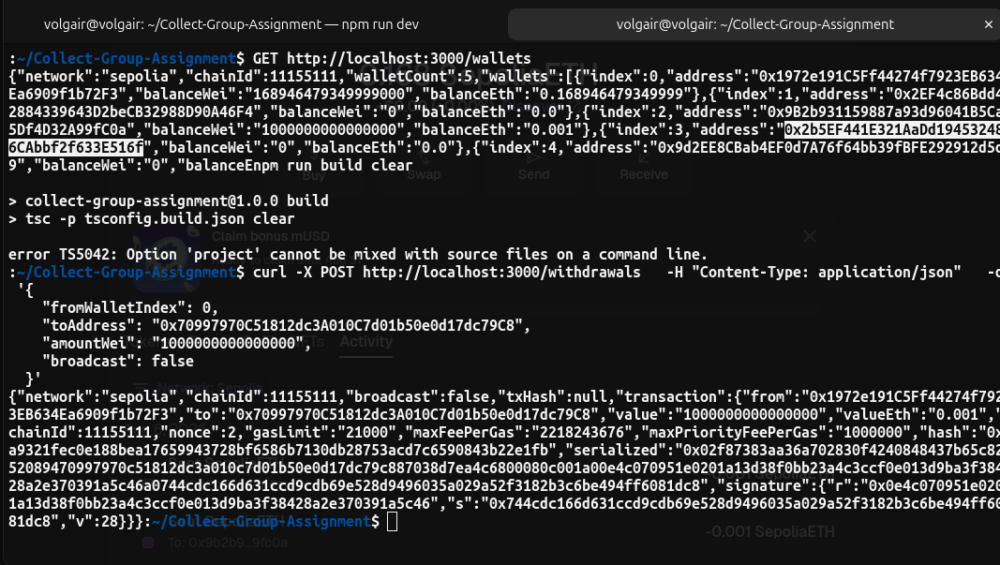
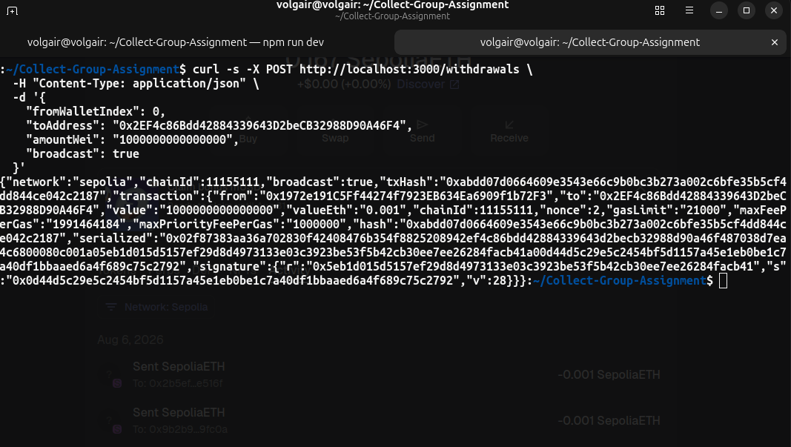
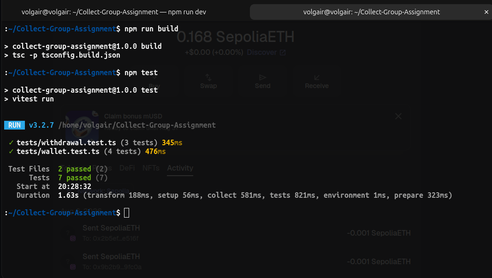

# Wallet Watcher & Withdrawal Builder

A Node.js + TypeScript custody backend slice for **Ethereum Sepolia**. The service derives deterministic HD wallets, tracks native ETH balances, logs balance changes, and builds or broadcasts withdrawal transactions.

## Features

- Deterministic wallet generation (BIP-39 + BIP-44, indices `0..N-1`)
- Balance polling against Sepolia with persisted balances (SQLite)
- Balance-change ledger (inflows from tracking, outflows only on broadcast)
- REST API for wallet balances and withdrawals
- ERC-7715 session permissions (grant, inspect, revoke, redeem) with expiry and spending policies
- Asset reporting: native and ERC-20 balances across every wallet, with totals
- Sole-owner access control: one address, enforced at boot and on every request
- Runs on Sepolia or mainnet, with per-chain guardrails when funds are real
- Unit tests for wallet derivation, transaction building, permissions and network config

## Wallet derivation (BIP-39 / BIP-44)

Wallets are **not** generated with `Wallet.createRandom()` in a loop. The service uses standard hierarchical deterministic (HD) derivation so the wallet at each index is stable across runs.

| Standard | Role in this project |
|----------|----------------------|
| **BIP-39** | `WALLET_MNEMONIC` in `.env` is the master seed phrase |
| **BIP-32** | Used internally by ethers to derive child keys from that seed |
| **BIP-44** | Ethereum account paths with coin type `60'` |

Derivation path for wallet at index `i`:

```
m/44'/60'/0'/0/{i}
```

Examples:

```
m/44'/60'/0'/0/0   → wallet index 0
m/44'/60'/0'/0/1   → wallet index 1
m/44'/60'/0'/0/2   → wallet index 2
```

This satisfies the assignment's determinism rules:

- Same `N` → same wallet list every run
- `N + m` → original `N` wallets unchanged, plus `m` new ones at higher indices
- `N − m` → subset of the wallets produced for `N`

Implementation: `HDNodeWallet.fromMnemonic()` in `src/domain/wallet/wallet.service.ts`.

## Networks

The same code runs against Sepolia or Ethereum mainnet. One mnemonic produces
**the same addresses on both chains**, so balances and the ledger are only
meaningful per chain — the database is pinned to the chain it was created on and
the service refuses to open it on another (`DATABASE_PATH` per chain).

| `CHAIN` | Chain ID | RPC variable | Guardrails |
|---------|----------|--------------|------------|
| `sepolia` (default) | 11155111 | `SEPOLIA_RPC_URL` | none — value uncapped, unbounded grants allowed |
| `mainnet` | 1 | `MAINNET_RPC_URL` | opt-in required, per-transaction cap, 24h grant cap, `spending-cap` mandatory |

### Mainnet guardrails

Mainnet moves real funds, so it is deliberately harder to run than a testnet:

| Rail | Default | Effect |
|------|---------|--------|
| `MAINNET_ENABLED` | unset | The service **refuses to boot** on mainnet unless this is exactly `true` |
| `MAINNET_MAX_TX_VALUE_WEI` | `100000000000000000` (0.1 ETH) | Ceiling on any single transaction, enforced for both `POST /withdrawals` and permission redemptions |
| `MAINNET_MAX_GRANT_EXPIRY_SECONDS` | `86400` (24h) | Longest permission grant accepted on mainnet |
| `MAINNET_ALLOW_UNBOUNDED_GRANTS` | `false` | Grants without a `spending-cap` policy are rejected |
| `DATABASE_PATH` | `./data/mainnet-wallets.db` | Separate store from the testnet database |
| `API_TOKENS` | unset | Refuses to boot on mainnet with an unauthenticated API |

On boot the service prints the guardrails in effect:

```
Network: mainnet (chainId 1) — MAINNET
*** MAINNET: real funds are at risk. Guardrails in effect:
***   per-transaction limit:     0.1 ETH
***   max permission grant:      86400s
***   unbounded grants allowed:  false
***   database:                  ./data/mainnet-wallets.db (bound to mainnet)
Initialized 5 wallet(s) on mainnet
```

None of this is a substitute for an approval process, a hardware signer, or a
withdrawal allowlist — see [Security notes](#security-notes).

## Requirements

- Node.js 20+
- An RPC URL for the chain you are running (Alchemy, Infura, or a public endpoint)
- A mnemonic for wallet derivation — use a testnet-only mnemonic unless you
  intend to run against mainnet, and treat it as a production secret if you do

## Setup

```bash
npm install
cp .env.example .env
```

Edit `.env` and set at minimum:

- `SEPOLIA_RPC_URL`
- `WALLET_MNEMONIC`

## Run

Development:

```bash
npm run dev
```

Production build:

```bash
npm run build
npm start
```

Tests:

```bash
npm test
```

## Demo walkthrough (for screenshots)

Run these in order in a separate terminal while `npm run dev` is running.

**1. Start the service**

```bash
npm run dev
```

Screenshot: terminal showing `Initialized 5 wallet(s) on sepolia` and `Server listening on http://localhost:3000`.



**2. List wallets and balances**

```bash
GET http://localhost:3000/wallets
```

Screenshot: JSON response with wallet addresses and balances (fund wallet index 0 via a Sepolia faucet first if balances are zero).



**3. Build a withdrawal (no broadcast)**

```bash
curl -X POST http://localhost:3000/withdrawals   -H "Content-Type: application/json"   -d '{
    "fromWalletIndex": 0,
    "toAddress": "0x70997970C51812dc3A010C7d01b50e0d17dc79C8",
    "amountWei": "1000000000000000",
    "broadcast": false
  }'
```

Screenshot: response with `"broadcast": false`, `"txHash": null`, and signed `transaction` fields (`serialized`, `hash`, `signature`).



**4. Broadcast a withdrawal (optional)**

Send to one of your own derived wallet addresses from step 2:

```bash
curl -s -X POST http://localhost:3000/withdrawals \
  -H "Content-Type: application/json" \
  -d '{
    "fromWalletIndex": 0,
    "toAddress": "0x2EF4c86Bdd42884339643D2beCB32988D90A46F4",
    "amountWei": "1000000000000000",
    "broadcast": true
  }'
```

Screenshot: response with `"broadcast": true` and a `txHash`. After the next poll, screenshot `GET /wallets` again showing the updated balance.



**5. Run unit tests**

```bash
npm test
```

Screenshot: terminal showing all tests passing (wallet generation + transaction building).



## Configuration

| Variable | Description | Default |
|----------|-------------|---------|
| `CHAIN` | `sepolia` or `mainnet` | `sepolia` |
| `SEPOLIA_RPC_URL` | Sepolia JSON-RPC endpoint | required when `CHAIN=sepolia` |
| `MAINNET_RPC_URL` | Mainnet JSON-RPC endpoint | required when `CHAIN=mainnet` |
| `MAINNET_ENABLED` | Opt in to running on mainnet | unset (refuses to boot) |
| `MAINNET_MAX_TX_VALUE_WEI` | Mainnet per-transaction ceiling, in wei | `100000000000000000` (0.1 ETH) |
| `MAINNET_MAX_GRANT_EXPIRY_SECONDS` | Longest mainnet permission grant | `86400` |
| `MAINNET_ALLOW_UNBOUNDED_GRANTS` | Allow mainnet grants without a `spending-cap` | `false` |
| `OWNER_ADDRESS` | The one address permitted to act; enforced at boot and per request | unset (any configured token may act) |
| `API_TOKENS` | That owner's credential, as `<ownerAddress>:<secret>` | unset (API unauthenticated) |
| `WITHDRAWAL_ALLOWLIST` | Recipient addresses withdrawals may target | empty (any destination) |
| `WITHDRAWAL_MAX_VALUE_WEI` | Per-transaction ceiling on any chain | unset |
| `WITHDRAWAL_MAX_PER_WINDOW_WEI` | Max outflow per wallet per window | unset |
| `WITHDRAWAL_WINDOW_SECONDS` | Velocity window | `86400` |
| `TRACKED_CONTRACT` | Contract to report in `GET /assets` | `0xee1DC6BC…` |
| `MAINNET_TRACKED_CONTRACT` | Mainnet override of the above | unset (falls back to `TRACKED_CONTRACT`) |
| `SEPOLIA_TRACKED_CONTRACT` | Sepolia override of the above | unset (falls back to `TRACKED_CONTRACT`) |
| `WALLET_MNEMONIC` | BIP-39 mnemonic for wallet derivation | required |
| `WALLET_COUNT` | Number of wallets to manage (1–20) | `5` |
| `POLL_INTERVAL_MS` | Balance polling interval | `120000` (2 min) |
| `PORT` | HTTP server port | `3000` |
| `DATABASE_PATH` | SQLite database path | `./data/wallets.db` |
| `PERMISSIONS_MAX_EXPIRY_SECONDS` | Longest accepted permission grant | `2592000` (30 days) |
| `PERMISSIONS_DEFAULT_EXPIRY_SECONDS` | Grant expiry when a request omits it | `3600` (1 hour) |

## API

### `GET /health`

Health check.

### `GET /wallets`

Returns all configured wallets and their persisted balances.

Example response:

```json
{
  "network": "sepolia",
  "chainId": 11155111,
  "walletCount": 5,
  "wallets": [
    {
      "index": 0,
      "address": "0x...",
      "balanceWei": "1000000000000000",
      "balanceEth": "0.001"
    }
  ]
}
```

### `GET /assets`

Native **and** ERC-20 balances, read live from the chain. Use `?walletIndex=N`
for a single wallet, or omit it for every wallet plus totals.

The contract to report on comes from `TRACKED_CONTRACT`:

```
TRACKED_CONTRACT=0xee1DC6BCF1Ee967a350e9aC6CaaAA236109002ea
```

A contract address only means something on **one** chain — the same address is
usually an empty account elsewhere. Set `MAINNET_TRACKED_CONTRACT` (or
`SEPOLIA_TRACKED_CONTRACT`) when the two chains use different deployments; it
overrides `TRACKED_CONTRACT` for that network.

Comma-separated addresses are accepted if you want to watch more than one.
Balances are read with ERC-20 calls, so if the tracked contract is not an
ERC-20, its token entry reports an `error` while the native balance is still
returned.

Read-only `eth_call` — it signs nothing and does not touch the persisted
balances, which the poller owns.

```json
{
  "network": "sepolia",
  "chainId": 11155111,
  "walletCount": 5,
  "trackedContracts": ["0xee1DC6BCF1Ee967a350e9aC6CaaAA236109002ea"],
  "contracts": [
    {
      "address": "0xee1DC6BCF1Ee967a350e9aC6CaaAA236109002ea",
      "name": "Across Bond Token",
      "symbol": "ABT",
      "decimals": 18,
      "totalSupplyRaw": "1000000000000000000000",
      "totalSupplyFormatted": "1000.0",
      "owner": "0x…",
      "ownerIsServiceOwner": false,
      "hubPool": "0xc186fA914353c44b2E33eBE05f21846F1048bEda",
      "restrictedDestination": "0xc186fA914353c44b2E33eBE05f21846F1048bEda",
      "restriction": "Transfers to any address are unrestricted, except to the hubPool…",
      "ethReserveRaw": "42591000000000000000",
      "ethReserveFormatted": "42.591",
      "fullyBacked": true,
      "unwrapFunction": "withdraw",
      "error": null
    }
  ],
  "totals": {
    "nativeWei": "5000000000000000000",
    "nativeEth": "5.0",
    "tokens": [
      {
        "address": "0xee1dc6bcf1ee967a350e9ac6caaaa236109002ea",
        "symbol": "TST",
        "decimals": 18,
        "totalRaw": "1234500000000000000000",
        "totalFormatted": "1234.5"
      }
    ]
  },
  "wallets": [
    {
      "index": 0,
      "address": "0x...",
      "nativeWei": "1000000000000000000",
      "nativeEth": "1.0",
      "tokens": [
        {
          "address": "0xee1DC6BCF1Ee967a350e9aC6CaaAA236109002ea",
          "symbol": "TST",
          "decimals": 18,
          "balanceRaw": "1234500000000000000000",
          "balanceFormatted": "1234.5",
          "canTransferToRestrictedDestination": true,
          "error": null
        }
      ]
    }
  ]
}
```

Two behaviours worth knowing, because real tokens are messy:

- `symbol()` and `decimals()` are treated as **optional**. If either reverts you
  get `null` for that field, but the balance is still reported — a token with a
  broken label does not disappear from the report.
- If `balanceOf` reverts, that token reports `error` and a zero balance rather
  than failing the whole request. A `balanceOf` failure across **every** token
  usually means the RPC is pointed at the wrong chain.

### The tracked contract is Across' Bond Token

`0xee1DC6BCF1Ee967a350e9aC6CaaAA236109002ea` is Across Protocol's **BondToken**
— "Across Bond Token", **ABT**. It is WETH9 plus an Ownable proposer allowlist,
compiled with solc 0.8.18 (viaIR, optimiser 1,000,000 runs). Its `hubPool` is
pinned at construction to `0xc186fA914353c44b2E33eBE05f21846F1048bEda`, Across'
Hub Pool V2 on **Ethereum mainnet**, so this is a mainnet contract.

It overrides exactly one function:

```solidity
function transferFrom(address src, address dst, uint256 amt)
    public override returns (bool)
{
    if (dst == address(hubPool)) {
        require(
            proposers[src] || hubPool.rootBundleProposal().proposer != src,
            "Transfer not permitted"
        );
    }
    return super.transferFrom(src, dst, amt);
}
```

**The gate is destination-scoped, not sender-scoped.** In plain terms:

- You can transfer ABT to **any ordinary address**, freely. No permission.
- You can **unwrap it to ETH** with `withdraw(uint256)`, which is not gated.
- The only transfer that can revert is one **to the hubPool**, and only while you
  are the pending root-bundle proposer and not an approved proposer. That is the
  bond-staking path, not ordinary use.

`GET /assets` reports `canTransferToRestrictedDestination` per wallet: `true`
means nothing would block a hubPool transfer, `false` means it would revert, and
`null` means it could not be determined.

Two things that remain true regardless:

- The contract's `owner()` is an on-chain role that can call
  `setProposer(address,bool)`. **It is not this service's `OWNER_ADDRESS`** —
  the two are unrelated. Becoming the contract's owner requires the current
  contract owner to call `transferOwnership`; no configuration file here can do
  it, and this service holds no such key.
- ABT is ETH-backed: `totalSupply()` returns `address(this).balance`, so 1 ABT
  is redeemable for 1 wei of ETH **provided the contract actually holds it**.
  Compare your balance against `contracts[].totalSupplyRaw` before relying on
  that.

One implementation detail worth knowing: WETH9's `withdraw` pays out with
`transfer()`, which forwards only the 2300-gas stipend. That is fine for an EOA
wallet, and will revert for a contract recipient without a cheap `receive()`.

### "Owner" does not mean "can withdraw"

Three different things get called the owner here, and only one of them can move
value:

| Role | What it can do | What it cannot do |
|------|----------------|-------------------|
| Contract `owner()` (Ownable) | `setProposer`, `transferOwnership`, `renounceOwnership` | touch ETH or ABT — there is no owner-withdraw function |
| `OWNER_ADDRESS` in this service | authenticate to this API and request withdrawals | anything on chain by itself; it is a bearer credential, not a key |
| A wallet that **holds ABT** | `transfer` it, or `withdraw()` it into ETH | — |

The ETH sitting in the BondToken contract is **not** claimable by an owner. It
is the redemption backing for the ABT in circulation — `totalSupply()` is
defined as `address(this).balance`. The only route to any of it is to hold ABT
and redeem it. `GET /assets` reports both sides: `totalSupplyRaw`, and
`ethReserveRaw` / `fullyBacked` to confirm the backing is really there.

So the first question is never "am I the owner?" — it is
`balanceOf(<my address)`, which `GET /assets` answers for every derived wallet.

One more constraint, stated plainly because it bites late: **this service signs
only for the wallets derived from `WALLET_MNEMONIC`.** An address that is not
one of them can be the API owner, can be allowlisted as a destination, and can
be reported on — but the service cannot sign a transaction for it.

`getContractInfo` reports `ownerIsServiceOwner`, which compares the live
`owner()` against your configured `OWNER_ADDRESS`. Expect `false`; the two roles
are unrelated by design.

### Who deployed it, and why that is not you

The contract was created by `0x9A8f92a830A5cB89a3816e3D267CB7791c16b04D`.
OpenZeppelin's `Ownable` constructor runs `_transferOwnership(_msgSender())`, so
**the deployer starts out as the owner** — and that address is Across'
deployment account, not yours.

That settles the ownership question unless `transferOwnership` was called later,
which only reading `owner()` from chain can confirm (`GET /assets` does exactly
that). Either way it changes nothing about access to the ETH:

- Even as contract owner you could not withdraw a wei. Ownable exposes
  `setProposer`, `transferOwnership` and `renounceOwnership` — nothing else.
- `setProposer` would only let an address transfer ABT **to the hubPool**, which
  is the bond-staking path. It has no bearing on ordinary transfers or on
  `withdraw()`.

So the question remains the one from before, and it is the only one that
matters: **does `0x2ddfbeca…` — or any wallet derived from your mnemonic — hold
ABT?**

### `POST /assets/unwrap`

One of two ways to turn ABT into ETH — the other being a plain `transfer` to
any non-hubPool address. Use this when you want the ETH **in the same wallet**,
for example before moving it on with `POST /withdrawals`.

```bash
curl -s localhost:3000/assets/unwrap \
  -H "Authorization: Bearer $OWNER_SECRET" \
  -H 'Content-Type: application/json' \
  -d '{"fromWalletIndex":0,"amountWei":"1000000000000000000","broadcast":false}'
```

- Reads the wrapped balance **before** building, so an over-amount fails here
  rather than reverting on chain and burning gas.
- Checks the contract's ETH reserve too. `withdraw()` pays out of ETH the
  contract holds, so if it is short the transaction would revert — the request
  is refused with "not fully backed" instead.
- Refuses to guess: exactly one contract must be tracked, and the amount is
  explicit. There is no "unwrap everything".
- `broadcast` defaults to `false`. Nothing is sent unless you ask.
- Records **no** ledger outflow. The value never leaves the wallet — it changes
  shape. Step two records the movement when the ETH actually goes out.

### `POST /withdrawals`

Builds a withdrawal from a wallet index to a destination address.

Request body:

```json
{
  "fromWalletIndex": 0,
  "toAddress": "0x70997970C51812dc3A010C7d01b50e0d17dc79C8",
  "amountWei": "1000000000000000",
  "broadcast": false
}
```

- `broadcast: false` — returns the signed transaction JSON (payload + signature). No outflow is recorded.
- `broadcast: true` — sends the transaction to Sepolia and records an outflow in the ledger.

Example response (`broadcast: false`):

```json
{
  "network": "sepolia",
  "chainId": 11155111,
  "broadcast": false,
  "txHash": null,
  "transaction": {
    "from": "0x...",
    "to": "0x...",
    "value": "1000000000000000",
    "valueEth": "0.001",
    "chainId": 11155111,
    "nonce": 0,
    "gasLimit": "21000",
    "maxFeePerGas": "...",
    "maxPriorityFeePerGas": "...",
    "hash": "0x...",
    "serialized": "0x02...",
    "signature": {
      "r": "0x...",
      "s": "0x...",
      "v": 27
    }
  }
}
```

## Session permissions (ERC-7715)

Beyond signing every withdrawal with the account key, the service can hand out
**scoped, expiring permissions** using the same shape as the
[`wallet_grantPermissions`](https://www.openfort.io/docs/products/cross-app-wallet/rpc/wallet_grantPermissions)
RPC ([ERC-7715](https://github.com/ethereum/ERCs/blob/master/ERCS/erc-7715.md)).

A grant registers a **session signer** on an account together with the
permissions and policies that bound what it may do. The session key is derived
per grant and is what authorises a redemption; the account key is what actually
executes it.

### How it works

| Step | What happens |
|------|--------------|
| Grant | `POST /permissions` builds the `wallet_grantPermissions` request, derives a fresh session key, hashes the permissions, signs the grant digest with the account key, and persists the session |
| Store | Only a random 32-byte seed is persisted. The session key is re-derived as `keccak256(accountKey ‖ seed)`, so a database leak alone yields nothing without the mnemonic |
| Redeem | `POST /permissions/:id/redeem` checks status/expiry/policies, signs the action digest with the re-derived session key, verifies the signature recovers to the granted signer, then builds (and optionally broadcasts) the withdrawal with the account key |

### Deviation from a full smart-account flow

The accounts here are plain EOAs derived from the HD mnemonic, so there is no
on-chain permission validator to redeem against. In a full ERC-7715 setup the
session key signs a UserOperation and a smart account executes it; here the
session key authorises and **this backend** executes, after enforcing the grant
itself. The payloads, hashing and `permissionsContext` are otherwise faithful to
the spec, so the grant can be handed to a wallet that speaks ERC-7715 (for
example the Rapidfire ID sample wallet) unchanged.

### The current spec shape

ERC-7715 has moved on since `wallet_grantPermissions` was written, and the two
differ in ways that change what a request means:

| Openfort shape (still supported) | Current ERC-7715 |
|---|---|
| `wallet_grantPermissions` | `wallet_requestExecutionPermissions` |
| `expiry` as a duration | `rules: [{type:"expiry", data:{timestamp}}]` |
| `policies: [{type,data}]` | `rules: [{type,data}]` |
| — | `permission.isAdjustmentAllowed` |
| `permissionsContext` | `context` |
| `factory` / `factoryData` | `dependencies: [{factory,factoryData}]` |
| — | `delegationManager` |

Rather than run two engines that can drift apart, the spec shape is translated
onto the same grant engine, so there is one enforcement path and two wire
formats:

| Endpoint | Method |
|---|---|
| `GET /permissions/supported` | `wallet_getSupportedExecutionPermissions` |
| `POST /permissions/request` | `wallet_requestExecutionPermissions` |
| `POST /permissions/redeem-delegation` | builds the ERC-7710 `redeemDelegation` call |

```bash
curl -X POST localhost:3000/permissions/request -H 'content-type: application/json' -d '{
  "fromWalletIndex": 0,
  "request": {
    "chainId": "0xaa36a7",
    "to": "0x016562aA41A8697720ce0943F003141f5dEAe006",
    "permission": {
      "type": "native-token-allowance",
      "isAdjustmentAllowed": false,
      "data": { "allowance": "0x0DE0B6B3A7640000" }
    },
    "rules": [{ "type": "expiry", "data": { "timestamp": 1735689600 } }]
  }
}'
```

An allowance is translated into a `spending-cap` policy, because that is what
the enforcement path already checks and both mean "no more than this, in total".

Three things are refused rather than guessed:

- **A foreign `chainId`.** A permission scoped to another chain is a mistake
  waiting to be replayed, so it is rejected.
- **A `from` that is not the granting wallet.** Granting anyway would return a
  permission naming an account that never consented.
- **An absent `delegationManager`.** The response reports it as null with a
  warning instead of inventing an address to send a redeemer to.

| Variable | Purpose |
|---|---|
| `PERMISSIONS_DELEGATION_MANAGER` | The ERC-7710 manager redemption goes through |
| `PERMISSIONS_ACCOUNT_FACTORY` | Factory for accounts that must be deployed first |
| `PERMISSIONS_ACCOUNT_FACTORY_DATA` | Calldata for that factory — required whenever the factory is set |

Redemption encodes each action as the spec's `Execution` struct:

```
encodePacked(["address", "uint256", "bytes"], [target, value, callData])
```

and calls `redeemDelegation(bytes[] contexts, bytes32[] modes, bytes[] executions)`.
Calldata only — nothing is broadcast. One wrinkle worth knowing: the ERC's
interface block says `redeemDelegation` while its own pseudocode says
`redeemDelegations`, and real deployments differ, so both are supported and the
caller picks the one its manager uses.

### Encoding

Every field is hashed with a fixed layout so both sides can recompute it:

```
selector(signature)  = 4-byte selector, or keccak256(signature)[0:4]
dataHash             = keccak256(abi.encode(address, keccak256(selectors)))
policiesHash         = keccak256(concat(policyHash...))  |  0x00..00 when empty
permissionHash       = keccak256(abi.encode(PERMISSION_TYPEHASH,
                           keccak256(type), dataHash, policiesHash))
permissionsHash      = keccak256(concat(permissionHash...))
grantDigest          = keccak256(abi.encode(GRANT_TYPEHASH, account,
                           signerHash, expiry, permissionsHash))
permissionsContext   = 0x77150001 ++ abi.encode(account, signerHash,
                           expiry, permissionsHash)
```

`0x77150001` is a 4-byte tag — ERC number `7715`, encoding version `1` — so a
verifier can tell this context apart from any other opaque blob. Contexts are
self-describing and can be decoded with `GET /permissions/context/:context`
without trusting a `sessionId`.

### Enforced policies

| Policy | Data | Effect |
|--------|------|--------|
| `spending-cap` | `{ "limit": "<wei>" }` | Cumulative native value the session may move. The strictest cap across all granted permissions wins |
| `value-limit` | `{ "limit": "<wei>" }` | Maximum native value in a single redemption |

Other policy types are hashed into the permission (so they are faithfully
recorded in the grant) but are not enforced by this backend.

Only `native-token-transfer` permissions are executable today. ERC-20 / 721 /
1155 and `contract-call` permissions can be granted — they are hashed, stored and
returned — but redeeming them fails with a clear `400`.

### API

#### `POST /permissions`

Request:

```json
{
  "fromWalletIndex": 0,
  "expiry": 604800,
  "signerType": "key",
  "permissions": [
    {
      "type": "contract-call",
      "data": {
        "address": "0x706aa5c8e5cc2c67da21ee220718f6f6b154e75c",
        "calls": [{ "signature": "transfer(address,uint256)" }]
      },
      "policies": []
    }
  ]
}
```

- `expiry` is a **duration in seconds** (as in the RPC). It is capped by
  `PERMISSIONS_MAX_EXPIRY_SECONDS` and defaults to
  `PERMISSIONS_DEFAULT_EXPIRY_SECONDS`.
- `signerType` is optional (`key` by default) and `permissions` must be
  non-empty.

Response (`201`, abridged — `request.permissions` echoes the body above and
`response.grantedPermissions` echoes that back) carries `request` (what a wallet
would receive), `response` (what it would return — note the absolute `expiry`)
and the stored `session`:

```json
{
  "network": "sepolia",
  "chainId": 11155111,
  "method": "wallet_grantPermissions",
  "request": { "expiry": 604800, "signer": { "type": "key", "data": { "id": "0x..." } }, "permissions": [] },
  "response": {
    "expiry": 1761561600,
    "grantedPermissions": [],
    "permissionsContext": "0x77150001..."
  },
  "session": {
    "id": 1,
    "walletIndex": 0,
    "account": "0x...",
    "status": "active",
    "expiresAt": "2026-10-27T15:00:00.000Z",
    "remainingSeconds": 604800,
    "spentWei": "0",
    "remainingWei": null,
    "nonce": 0
  }
}
```

#### `GET /permissions`

Optional `?walletIndex=N` filter. Returns every session with a derived `status`
of `active`, `expired` or `revoked`.

#### `GET /permissions/:id`

A single session.

#### `GET /permissions/context/:context`

Decodes a `permissionsContext` and reports whether it is `known` and `intact`
(its embedded `permissionsHash` matches the stored grant).

#### `POST /permissions/:id/revoke`

Revokes a session. Revocation is terminal; later redemptions fail.

#### `POST /permissions/:id/redeem`

```json
{
  "toAddress": "0x70997970C51812dc3A010C7d01b50e0d17dc79C8",
  "amountWei": "10000000000000000",
  "broadcast": true
}
```

Checks the session, the permission type and the policies, then signs the action
digest with the session key and builds the transfer with the account key.

Same headers as `POST /withdrawals`: `Authorization` when tokens are configured,
and `Idempotency-Key` whenever `broadcast: true`.

- `broadcast: false` (`200`) — authorisation only. Nothing is sent, and neither
  the spending cap nor the action nonce is consumed.
- `broadcast: true` (`201`) — sends the transaction, records the outflow ledger
  entry, adds the amount to `spentWei` and increments the nonce.

```json
{
  "broadcast": true,
  "txHash": "0x...",
  "authorization": {
    "actionDigest": "0x...",
    "nonce": 0,
    "sessionKeySignature": "0x...",
    "recoveredSigner": "0x..."
  },
  "transaction": { "...": "same shape as POST /withdrawals" },
  "session": { "nonce": 1, "spentWei": "10000000000000000", "remainingWei": "40000000000000000" }
}
```

### Demo walkthrough

```bash
# 1. Grant a session key that may move up to 0.05 ETH for a week
curl -s -X POST http://localhost:3000/permissions \
  -H "Content-Type: application/json" \
  -d '{
    "fromWalletIndex": 0,
    "expiry": 604800,
    "permissions": [{
      "type": "native-token-transfer",
      "data": {},
      "policies": [{ "type": "spending-cap", "data": { "limit": "50000000000000000" } }]
    }]
  }'

# 2. Redeem 0.01 ETH with that session key (no broadcast)
curl -s -X POST http://localhost:3000/permissions/1/redeem \
  -H "Content-Type: application/json" \
  -d '{"toAddress":"0x70997970C51812dc3A010C7d01b50e0d17dc79C8","amountWei":"10000000000000000","broadcast":false}'

# 3. Inspect the remaining allowance
curl -s http://localhost:3000/permissions/1

# 4. Revoke it
curl -s -X POST http://localhost:3000/permissions/1/revoke
```

## Sole owner

This service runs for **exactly one owner** — the address in `OWNER_ADDRESS`:

```
OWNER_ADDRESS=0x2ddfbeca5b62f310a5f8edefb4fc026a99b979ce
API_TOKENS=0x2ddfbeca5b62f310a5f8edefb4fc026a99b979ce:<secret>
```

That is enforced, not merely documented. On boot the process refuses to start
unless `API_TOKENS` holds **exactly one** entry and it is that address:

| Misconfiguration | Result |
|------------------|--------|
| No `API_TOKENS` entry at all | refuses to start — an empty list means an open API |
| A token bound to a different address | refuses to start |
| A second owner added alongside the right one | refuses to start |
| An `OWNER_ADDRESS` that is not an address | refuses to start |

Every request is checked against it as well, so the guarantee holds per call
and not only at boot. `GET /health` stays open for probes.

Generate a secret with:

```bash
openssl rand -hex 32
```

### Owner is who may ask; allowlist is where it may go

The owner is a **requester**, not a recipient. Where funds may be *sent* is a
separate list, and it ships restricted to the owner — so out of the box, funds
can only move to you:

```
WITHDRAWAL_ALLOWLIST=0x2ddfbeca5b62f310a5f8edefb4fc026a99b979ce
```

Add comma-separated addresses to widen it; empty it to allow any destination.

### Withdrawing whenever you want

Nothing here gates you by time. The velocity limits
(`WITHDRAWAL_MAX_PER_WINDOW_WEI` and `WITHDRAWAL_WINDOW_SECONDS`) are **unset by
default**, so there is no ceiling to hit and no window to wait out — the owner
can request a withdrawal at any moment. They are guardrails you may switch on:
set them and the service rejects any outflow that would exceed the ceiling
within the window.

The **owner address** — not a label — is recorded on each outflow ledger entry
and returned as `requestedBy`, so every movement is attributable.

Copy the configuration into your `.env` to activate it:

```bash
cp .env.example .env   # then set WALLET_MNEMONIC, the RPC url, and a real secret
```

Note that bearer secrets are only as strong as the secret itself: anyone who
holds one can act as that owner. If you want cryptographic proof of control
instead, the next step is request signing — the owner signs each withdrawal with
the address's key and the service verifies recovery before signing anything.

## Deriving a wallet and saving its key

```bash
npm run wallet:derive -- --index 5
```

Derives wallet 5 from the mnemonic in your `.env` and writes its private key to
`keys/wallet-5.json`.

- Mode `0600`, inside a `0700` directory, under a path `.gitignore` covers. It
  refuses to write anywhere git would pick up.
- The key is never printed. Terminal output ends up in scrollback, CI logs and
  shell history.
- It refuses to overwrite an existing key file — overwriting a live key destroys
  access to it.
- The mnemonic is read from the environment, never from an argument, so it does
  not land in shell history or `ps` output.
- It warns when the index is at or above `WALLET_COUNT`, because the service
  will not sign for a wallet it does not manage.

### What this cannot do

**You cannot derive a wallet from an address.** Derivation runs
mnemonic → private key → address, in one direction only. Recovering a private
key from an address is precisely what public-key cryptography makes infeasible.
So no tool — this one included — can produce a key for the contract deployer,
for a previous owner, or for any address whose seed you do not already hold.

What it *can* do is derive the next wallet from a mnemonic you already have.

Two specific cases, because the reasons they fail are different:

- **A contract has no private key at all.** `0xee1DC6BC…` is the BondToken
  contract. Contracts are controlled by their code, not by a key. There is no
  key to derive, to recover, or to lose — for anyone, ever. The concept simply
  does not apply to a contract.
- **An EOA's key belongs to whoever created it.** `0x9A8f92a8…` deployed that
  contract. The address is public; its private key is not derivable from it, not
  by this tool and not by any other. Only the party that generated it has it.

`npm run wallet:derive` detects an address passed as the seed and explains this
instead of failing with a stack trace. It rejects a raw 32-byte private key for
a related reason: a private key is a leaf — it controls exactly one address and
derives nothing beyond it.

**That wallet starts at zero.** It is a brand new address with no history and no
balance. It grants access to nothing that exists today. If a balance sits at some
other address, only the key for *that* address can move it — deriving a fresh
wallet does not reach it.

## The contract is the ledger, not the holder

One misconception decides everything downstream, so it is worth stating plainly:
that a contract holds the balances recorded in its own `balanceOf` mapping.

It does not. That mapping is a ledger stored *in* the contract's storage. The
keys are addresses; the values are amounts belonging to those addresses. The
contract keeps the record — it does not own the entries. For the contract to hold
its own token, `balanceOf(<the contract itself>)` would have to be greater than
zero, which is a readable fact. `GET /assets/holders` reads it.

This matters because of two properties of a WETH-style token:

- `withdraw(uint256)` is **ungated**. Anyone holding a balance can call it.
- It **burns** the balance and pays out ETH 1:1 from the contract's reserve.

So "who can take the ETH?" and "who holds the token?" are the same question with
the same answer. If no address you control holds ABT, the reserve is unreachable
— not because a feature is missing, but because no path exists. Ownership does
not help: `Ownable` has no withdraw. Being the deployer does not help. Deriving
a wallet does not help. Only holding the balance does.

### GET /assets/holders

Reads `balanceOf` for every address worth asking about — the contract itself
first, then the service owner, the deployer, then each derived wallet — and
reports:

- each balance, its share of supply, and the ETH it is redeemable for right now
- whether `withdraw()` for that balance would succeed today, capped at the
  reserve — a balance backed by no ETH is a claim on nothing
- whether this service can sign for the address. A balance it cannot sign for is
  a fact to report, not a balance it can move
- `unaccountedFor`: supply held outside the listed addresses. When that is the
  whole supply, none of these addresses holds the token
- a plain `verdict` reading the numbers, so nothing has to be inferred
- each address's ETH for gas, and an `accessStatus` classification (below)

### Who holds it, read on 2026-10-28

| Holder | Balance | Share of supply |
|---|---|---|
| UMA Store (`0x54f44eA3…`) | 34.5050 ABT | 81.01% |
| `0xf7bAc63f…` | 7.4850 ABT | 17.57% |
| Across Protocol HubPool V2 (`0xc186fA91…`) | 0.4500 ABT | 1.06% |
| Risk Labs Deployer (`0x9A8f92a8…`) | dust | — |

That accounts for the entire 42.591 supply. The contract holds none of it in
itself, and neither the service owner nor any derived wallet appears anywhere in
the holder list.

### Changing the on-chain owner: not possible, and it would not help

`transferOwnership` is `onlyOwner`, so it can only be sent by the current owner
— the Risk Labs deployer, whose key this service neither holds nor can derive.

And the role would not pay for itself if you had it. `Ownable` exposes
`setProposer`, `transferOwnership` and `renounceOwnership`. There is no
owner-withdraw, no mint, no rescue. The owner administers proposer rights for
transfers *into the hubPool* and nothing else.

Being the owner of this contract is not being a holder of the token. Only
holders can redeem the ETH.

## Your own token: deploy, mint, redeem

The tracked contract belongs to someone else, and every balance in it is theirs.
No role, key or amount of tooling reaches it. So instead of watching a balance
you cannot touch, deploy the same mechanics under your own key and run the whole
lifecycle yourself.

`contracts/WatcherWeth.sol` is a wrapped-ether token you deploy and own:

- **Minting is depositing.** `deposit()` locks ETH and mints the same amount.
- **Redeeming is withdrawing.** `withdraw(uint256)` is ungated: it burns the
  token and returns the ETH. Nobody, including the owner, can block a holder's
  redemption.
- **Always fully backed.** `totalSupply` equals the ETH the contract holds.
  There is deliberately **no owner-mint** — a supply you could conjure without
  backing is a supply you cannot honour when someone redeems it. That is a
  property, not an omission.
- **You are the owner.** The deployer becomes `owner`, which is the reachable
  version of "a wallet that owns the contract".

```bash
npm run token:compile                                        # regenerate the artifact
npm run token:deploy -- --index 0                            # plan: address + gas, sends nothing
npm run token:deploy -- --index 0 --broadcast                # deploy for real
```

Fund the deployer from a [Sepolia faucet](https://sepoliafaucet.com) first — an
unfunded account cannot pay gas. Planning and broadcasting are separate calls
because a deploy cannot be undone; you see the predicted address and the gas
before you pay.

Then point the service at it and mint:

```bash
TRACKED_CONTRACT=<deployed address>
npm run token:mint -- --contract <address> --amount 0.01 --index 0 --broadcast
GET  /assets          # your balance, the backing, whether it is fully covered
POST /assets/unwrap   # burn wWETH, take the ETH back out
```

The whole reporting stack works against it as-is: it has no `hubPool` or
`proposers`, so the service reports no transfer restriction rather than guessing.

**This is your token. It is not Across' Bond Token**, it is not affiliated with
Across or Risk Labs, and it must never be presented as either — not in a UI, not
to a counterparty, not in a listing. The name and symbol are deliberately
distinct so the two cannot be confused.

One trap worth knowing: `token:mint` points at any WETH-style contract, and
`deposit()` on the tracked contract is ungated, so it works there too. It is
also circular — you get back exactly the ETH you lock, and no claim on the
reserve already sitting there. The script says so when you aim it at the tracked
address.

### What gasless actually fixes

Paying for someone's gas tends to be proposed as though it were the last barrier
in general. It is the last barrier in exactly one situation, so every address is
classified:

| Status | Meaning | Does gasless help? |
|---|---|---|
| `nothing-to-redeem` | No balance — there is no claim to exercise | No. There is nothing to move |
| `gas-blocked` | A balance worth redeeming, no ETH to pay for it | **Yes — this is the case** |
| `ready` | A balance and the gas to move it | Unnecessary |

```bash
npm run addresses:confirm
```

prints the whole table live: every address, its balance, its share of supply,
its ETH, what is blocking it, and whether this service can sign for it.

It seeds the derived wallets itself, so it works on a fresh install without
booting the server first — a report that silently omitted every address you
control would be worse than no report at all.

`--offline` rebuilds the same report from `fixtures/holder-snapshot.json`
without touching a network:

```bash
npm run addresses:confirm -- --offline
```

It runs through the identical code path a live read uses, so it shows what the
output looks like before pointing at a chain. Every line is labelled as
recorded data, because a report that looks live and is not invites exactly the
confident wrong conclusions this project keeps having to walk back.

Unrecorded ETH reads as `?`, never `0`: a gap in a snapshot is not evidence
that an address has no gas, and reporting it as zero would mark holders
`gas-blocked` on the strength of data nobody collected.

### Submitting through a relay

Two implementations behind one interface, chosen by configuration:

| `GASLESS_RELAY_ENDPOINT` | Who pays |
|---|---|
| unset | The sender's ETH, submitted through the node |
| set | A relay submits the signed transaction and pays (`GASLESS_API_KEY` required) |

`POST /assets/unwrap` checks the sender can afford the gas before broadcasting
and reports the shortfall when it cannot, rather than letting the transaction
revert or stall. It refuses to submit to a relay without a key: an unauthenticated
relay endpoint is an open relay for anyone who finds it.

**This is not a Biconomy integration.** Biconomy's MEE replaces bundlers and
paymasters for **smart accounts** — the user signs a message rather than a
transaction, and the account executes it. Every wallet here is a plain EOA
derived from the mnemonic, and an EOA cannot sign a UserOperation, so MEE's
sponsored flow does not apply without first moving to a smart account.

What an EOA *can* do is hand a raw signed transaction to a relay that pays for
it, which is what `SponsoredRelayer` models. Standing that up needs an API key
and outbound network access, neither of which this sandbox has, so it ships
complete, tested against a mock, and unconfigured.

## Watching the addresses that decide it

The balance poller syncs *your* wallets. That is the right thing to do and it
answers the wrong question here: those wallets hold nothing, so a change in them
tells you nothing about the balance being watched. The balances that matter
belong to other people.

So the watcher polls them instead. Every interval it reads the holder set, diffs
it against the last observation, and records what moved. Nothing here
transacts — it is a watcher, not a strategy.

| Change | Meaning |
|---|---|
| `holder-redeemed` | ABT fell **and** the ETH reserve fell with it — someone burned the token and took the ETH. The supply just got smaller. |
| `holder-transferred` | ABT fell while the reserve held — it changed hands, nothing was redeemed |
| `holder-received` | ABT arrived somewhere |
| `reserve-moved` | The ETH backing moved with no change in balances |
| **`arrived`** | **ABT landed at an address this service can sign for** |

`arrived` is logged at warning level, because it is the only event that changes
what is *possible* rather than merely what is true.

```bash
GET /assets/holder-activity
```

returns everything recorded, newest first. Unchanged polls are not written, so
the history reads as a list of things that happened rather than a log of nothing
happening. Holder reads run in their own try/catch, so a failure to reach them
cannot stop the wallet sync from running.

## Holders

`npm run holders:scan` discovers who holds ABT by scanning `Transfer` and
`Deposit` logs, then reads each candidate's balance with `balanceOf` —
enumerate from logs, read balances live. It needs no indexer and no API key.

`npm run holders:scan -- --offline` replays a recorded history instead.


Withdrawals are catalogued in **[WITHDRAWALS.md](WITHDRAWALS.md)** — every
function that moves value, its selector, what it needs, and the exact
invocation, plus the reasons the administrative ones are out of reach.

Print the same thing without a server or a network:

```bash
npm run withdrawals
npm run withdrawals -- --id contract:withdraw
```

or read it over HTTP at `GET /assets/withdrawals`.

The catalogue is built from the contract's ABI rather than written by hand, so
it cannot drift from what is deployed — and anything in the ABI it does not
recognise is listed as `unclassified` rather than quietly omitted.

## Can you become the owner, and would it help?

Two separate questions, because they fail for unrelated reasons.

**Can the role be moved to you?** `transferOwnership` is `onlyOwner`: it must be
signed by whoever holds the role now. On the tracked contract that is the Risk
Labs deployer, which is not a wallet this service has keys for. No code path
produces that signature.

**Would holding it help?** That is a question about the ABI, and it is answered
from the ABI rather than from memory — `GET /assets/ownership` recomputes it
every run:

```
owner:                0x9A8f92a830A5cB89a3816e3D267CB7791c16b04D
is the deployer:      true
is service owner:     false
can be changed by us: no
owner may call:       renounceOwnership, setProposer, transferOwnership
can move value:       no
```

Every owner-gated function is administrative. Nothing the owner can call
transfers ETH or tokens. The functions that *do* move value — `deposit`,
`withdraw`, `transfer`, `transferFrom` — are ungated: they answer to whoever
holds a balance, not to whoever holds the title.

**Being made owner would give you a role, not a claim.**

The gated-function list is an input rather than a constant, for a specific
reason: hardcoded, this analysis could only ever answer "the owner cannot move
value", which would make it a rubber stamp rather than a check. Point it at a
contract where the owner genuinely controls funds and it says so.

## Evidence and on-chain verification

No event export ships with this repo. What ships is the tooling to check one.

Drop an ERC-20 event-log export into `evidence/` and verify it against a node
for the chain the logs came from:

```bash
npm run verify:events -- https://your-rpc-url --in evidence/<file>.json
```

The input path is **required** — the verifier deliberately defaults to nothing,
so it can never silently check the wrong dataset.

Nothing here has been run against a chain. Any dataset you bring starts
**UNVERIFIED** and stays that way until the command above passes.

For each row the verifier fetches the receipt and checks:

| Check | Failure means |
|-------|---------------|
| Transaction exists | `MISSING_TX` — wrong chain, or the hash is wrong |
| Block number and hash match | `MISMATCH` — the row was recorded against a different block |
| Contract address at that log index | `MISMATCH` — not the token you think it is |
| Topics and data byte-for-byte | `MISMATCH` — the decoded amount or parties differ |

It is read-only: it fetches receipts and compares fields, signs nothing, and
exits non-zero if any checkable row failed. Results are written beside the input
as `<input>.verified.json` (override with `--out`) with a per-row status.

Offline analysis, which needs no network:

```ts
import { loadEvidence, summarize, netFlows, unboundedApprovals } from "./src/domain/evidence/analysis.js";

const { rows } = loadEvidence("evidence/<file>.json");
summarize(rows);          // counts, unique txs/blocks, block range
netFlows(rows);           // per-address in/out/net from Transfer events
unboundedApprovals(rows); // approvals set to MAX_UINT256
```

Caveats carried over from the source data, and still true after verification:
matching event signatures do not prove token legitimacy, raw `uint256` values are
not human-readable without the token's decimals, and logs alone support no
conclusion about intent. Verification establishes that these events are really on
chain — nothing more.

The test suite runs this machinery against
`tests/fixtures/erc20-events.sample.json`, which is **synthetic** — invented
rows that exist only to cover the code paths. No row in it corresponds to a real
transaction, and it can never be verified against a chain.

## Funding test wallets

After starting the service, copy addresses from `GET /wallets` and fund them using a Sepolia faucet, for example:

- [POW Sepolia Faucet](https://sepolia-faucet.pk910.de/)
- [Google Cloud Sepolia Faucet](https://cloud.google.com/application/web3/faucet/ethereum/sepolia)

The balance poller will detect deposits within the configured polling interval (default 2 minutes, well within the 10-minute requirement).

## Deposit handling

This service uses **balance polling**, not per-transaction deposit indexing.

### Multiple deposits within one polling interval

If several deposits arrive between polls, the service only observes the **net on-chain balance** at poll time. It records **one inflow ledger entry** equal to:

```
new_balance - previous_balance
```

Individual deposits within the interval are not separated in the ledger.

### Service offline

If the service is down during incoming deposits, the next successful poll compares the current on-chain balance with the last persisted balance. Any increase is recorded as a **single catch-up inflow** for the total delta. Intermediate balance states while offline are not reconstructed unless tx-level backfill is added.

## Architecture

```
src/
├── config/                 # Environment configuration
├── domain/
│   ├── wallet/             # HD derivation
│   ├── balance/            # Balance sync + wallet views
│   ├── ledger/             # Outflow recording
│   ├── permissions/        # ERC-7715 grant/redeem + encoding
│   └── withdrawal/         # Tx build/sign/broadcast
├── infra/
│   ├── db/                 # SQLite persistence
│   └── rpc/                # ethers provider
├── api/                    # Express routes (wallets, withdrawals, permissions)
├── jobs/                   # Background balance poller
└── index.ts                # Entry point
```

## Trade-offs

| Decision | Rationale |
|----------|-----------|
| Native ETH on Sepolia | Simplest asset; avoids ERC-20 contract and approval logic |
| SQLite | Zero-setup persistence suitable for a take-home demo |
| Polling (2 min default) | Meets the 10-minute SLA with simpler ops than WebSocket subscriptions |
| Re-derive keys at sign time | Private keys are not stored in the database |
| Session key = KDF(account key, stored seed) | Session keys are re-derivable but a database leak alone is useless without the mnemonic |
| Only `native-token-transfer` is redeemable | No ERC-20 validator or allowance plumbing on the EOA custody path |
| Broadcast redemptions consume the cap | Build-only redemptions stay side-effect free |
| No deposit aggregation | Out of assignment scope; documented behavior instead |
| Mainnet guardrails instead of a policy engine | Bounds blast radius without pretending to be an approval workflow |
| Database pinned to one chain | Addresses repeat across chains; mixing ledgers would silently corrupt balances |

## Security notes

- Default to Sepolia. Mainnet is opt-in per boot, not per request, and only
  with `MAINNET_ENABLED=true`
- The guardrails here are a speed limit, not a policy engine: they bound how
  much a single transaction or session can move, but anyone who can reach the
  API can still spend up to that bound. For real custody add authentication,
  an approval step, an address allowlist and a hardware-backed signer
- Do not reuse a testnet mnemonic on mainnet, and treat a mainnet mnemonic as a
  production secret — every derived key is reachable from it
- Never commit `.env` or secrets
- Private keys are derived in memory from `WALLET_MNEMONIC` when signing
- Permission sessions are enforced by this service, not by an on-chain
  validator: revoking is a database flag, and policy checks happen at redemption
  time. Treat the database as part of the trust boundary
- `spending-cap` and `value-limit` bound **native** value only; they do not
  constrain ERC-20 `transfer` amounts, which this backend does not execute
